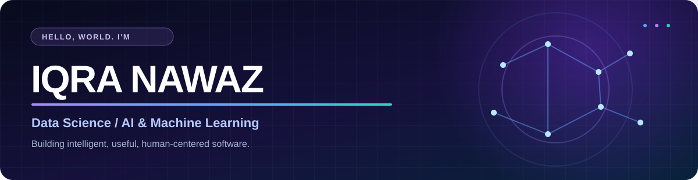

<!-- GITHUB PROFILE README | Replace YOUR_USERNAME everywhere before publishing. -->
<div align="center">



<br/>


<br/>

<a href="https://github.com/YOUR_USERNAME?tab=repositories"></a>
<a href="https://www.linkedin.com/in/YOUR_LINKEDIN/"></a>

</div>

---

### `> whoami`

I'm **Iqra**, a Data Science developer with a focus on **AI, machine learning, NLP, and useful automation**. I enjoy translating complicated problems into simple, practical tools—from understanding text to organizing digital workflows.

- 🎓 Data Science · NED University
- 🧠 Focus: Applied ML, NLP, intelligent automation and explainable solutions
- 🛠️ Building: End-to-end applications that connect models to clean, usable interfaces
- 🌱 Learning: Agentic AI, MLOps, and production-ready ML workflows

---

### `> tech_stack`

<div align="center">

**Languages & development**


**Data & machine learning**


<br/>


</div>

> **Customization:** Remove any tools above you haven't actually used. A focused, accurate stack is more impressive than a long one.

---

### `> featured_builds`

<table>
<tr>
<td width="50%" valign="top">

#### 📸 Screenshot Organizer
**OCR · Python · Automation**

A background workflow that recognizes screenshot content, generates meaningful filenames, and organizes images automatically.

**Highlights:** content-based naming · categorization · organization dashboard

<a href="https://github.com/YOUR_USERNAME/Screenshot_Organizer">View repository ↗</a>
</td>
<td width="50%" valign="top">

#### 💬 Review Sentiment Analysis
**NLP · Machine Learning · Text Classification**

A product-review sentiment classifier with preprocessing, model evaluation, and a user-facing analysis experience.

**Highlights:** text features · sentiment prediction · evaluation

<a href="https://github.com/YOUR_USERNAME">View projects ↗</a>
</td>
</tr>
<tr>
<td width="50%" valign="top">

#### 🩺 Medicine Recommendation System
**Python · Data Science · Decision Support**

A healthcare-oriented application that explores data-driven medicine information and recommendations, with an emphasis on responsible usage.

**Highlights:** structured data · recommendation workflow · application UI

<a href="https://github.com/YOUR_USERNAME">View projects ↗</a>
</td>
<td width="50%" valign="top">

#### ⚡ Utility Bill Decoder
**AI · Document Understanding · Validation**

An intelligent document-processing project that extracts information from utility bills and answers questions grounded in bill data.

**Highlights:** extraction · validation · question answering

<a href="https://github.com/YOUR_USERNAME">View projects ↗</a>
</td>
</tr>
</table>

---

### `> github_analytics`

<div align="center">


<br/>


</div>

<sub>GitHub charts are generated by external services and may sometimes be unavailable. Language stats reflect public repository code, not overall skill.</sub>

---

### `> what_i_care_about`

```text
01 / BUILD       Turn ideas into working applications.
02 / LEARN       Keep experimenting with ML and emerging AI systems.
03 / EXPLAIN     Make complex technology understandable and useful.
04 / IMPROVE     Test, iterate, document, and ship better software.
```

<div align="center">


<sub>Thanks for visiting · Explore a project, share feedback, or connect.</sub>

</div>
